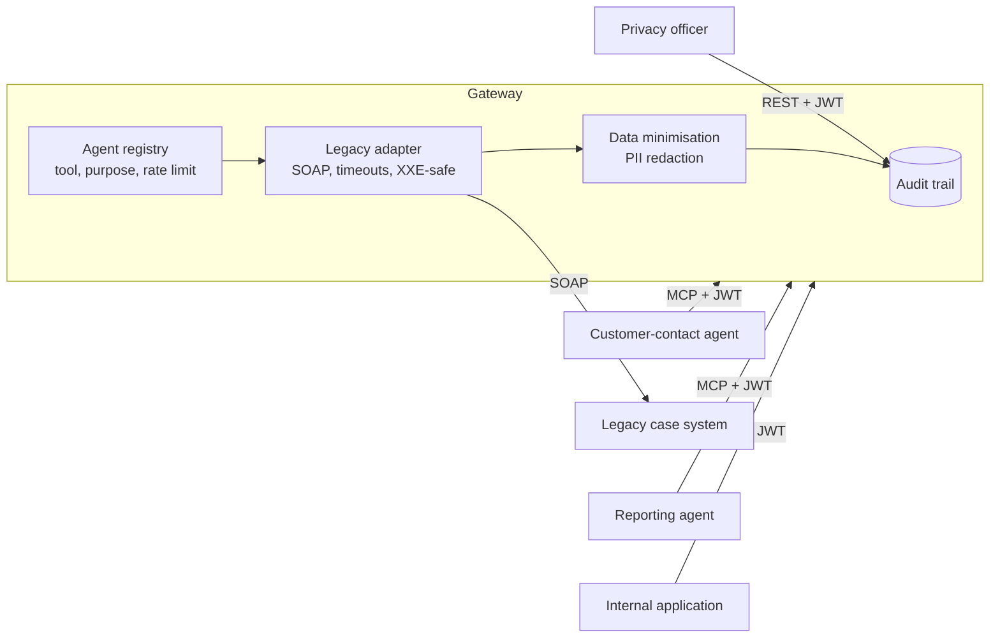

# Agent-ready legacy

[](https://github.com/itqaanconsulting/agent-ready-legacy/actions/workflows/build.yml)

**Let AI agents use a legacy government system safely, without rebuilding the system and without handing agents the keys.**

Municipalities want assistants and AI agents that can answer "what is the status of my permit?". The data sits in a case system from 2008 with a SOAP interface, and it is full of personal data: BSN numbers, names, phone numbers and case notes. Connecting an agent directly to that system raises questions that every privacy officer, CISO and auditor will ask:

- Which agent saw which data, and why?
- Can an agent that was built for customer contact also pull data for something else?
- What happens when an agent loops, or when the legacy system hangs?
- How do we show this to the regulator? Since 15 August 2026 municipalities are essential entities under the Cyberbeveiligingswet (NIS2), on top of the GDPR and the AI Act.

This project is the layer in between: a Java integration gateway that exposes the legacy system to agents through the **Model Context Protocol (MCP)** and to internal applications through **REST**, and enforces the rules in the gateway itself, not in the prompt.


**Demo (3 minutes, with voice-over in Dutch):*


https://github.com/user-attachments/assets/b030199a-9ad6-4f5f-94e2-8b76eba5450e


**English version:**


https://github.com/user-attachments/assets/693db5be-a0a7-4a44-ab4a-3673110a3972




## What the gateway enforces

| Concern | How |
|---|---|
| **Who is calling** | OAuth2 / OIDC JWT per agent (client credentials). The `mcp` scope is needed to connect at all. |
| **Deny by default** | An agent must be registered by client id. A valid token from an unknown client gets nothing. |
| **Least privilege** | Per agent: the tools it may call. The reporting agent sees status, not case notes. |
| **Purpose binding** (GDPR art. 5(1)(b)) | Every call states a purpose (`doel`); it must be one the agent is registered for. |
| **Data minimisation** | Agents never receive the initiator. Free text is redacted: names, BSN, IBAN, phone, e-mail, postcode. |
| **Accountability** | Every tool call is audited: agent, tool, purpose, case, outcome, reason. The audit trail holds no case content. |
| **Runaway agents** | A rate limit per agent (Bucket4j), applied before the other checks. |
| **Untrusted legacy** | Strict timeouts, validated input, XML parsing with DOCTYPEs disabled, no legacy error details passed on. |

The [architecture](docs/architecture.md) explains the design and the [threat model](docs/threat-model.md) lists threats, mitigations and residual risks, mapped to NIS2.

## Run the demo

Requires Java 21, Docker and Python 3.11+.

```bash
./mvnw package
docker compose up --detach --build

cd demo-agent
pip install -r requirements.txt
python demo_agent.py
```

The demo agents are scripted, so the run is repeatable without an LLM or API key. Each step is the tool call an LLM-driven agent would make:

```text
1. A citizen calls about her permit; the customer-contact agent looks it up
  klantcontact-agent -> zaak_samenvatting(zaaknummer=ZAAK-2026-000123, doel=KLANTCONTACT)
  ✓ zaaktype: Omgevingsvergunning bouwen
  ✓ status: IN_BEHANDELING
  ✓ afdeling: Vergunningen
  ✓ toelichting: [persoon] belde op [telefoon] over de dakkapel. Tekening nagestuurd naar [e-mail]. ...

2. The same agent wants the data for another purpose
  ✗ Geweigerd (PURPOSE_NOT_ALLOWED): Dit doel is niet toegestaan voor deze agent

4. ...but not the case notes
  ✗ Geweigerd (TOOL_NOT_ALLOWED): Deze agent mag deze tool niet gebruiken

Audit trail, as the privacy officer sees it (GET /api/v1/audit)
  agent                tool               doel          zaak              uitkomst
  klantcontact-agent   zaak_samenvatting  KLANTCONTACT  ZAAK-2026-000123  TOEGESTAAN
  klantcontact-agent   zaak_samenvatting  RAPPORTAGE    ZAAK-2026-000123  GEWEIGERD (PURPOSE_NOT_ALLOWED)
  ...
```

CI runs this same demo against the Docker Compose stack on every pull request.

### Connect your own MCP client

The MCP endpoint is `http://localhost:8080/mcp` (streamable HTTP). Get a development token for a registered agent and send it as a bearer token:

```bash
python demo-agent/dev_tokens.py klantcontact-agent mcp
```

## Configuration

Agents are registered in `application.yml` (or through environment variables), keyed by OAuth2 client id:

```yaml
gateway:
  agents:
    klantcontact-agent:
      tools: [zaak_status, zaak_samenvatting]
      doelen: [KLANTCONTACT]
      requests-per-minute: 30
    rapportage-agent:
      tools: [zaak_status]
      doelen: [RAPPORTAGE]
      requests-per-minute: 10
```

| Variable | Purpose |
|---|---|
| `SPRING_SECURITY_OAUTH2_RESOURCESERVER_JWT_ISSUER_URI` | Identity provider (for example Keycloak) that issues the agents' tokens |
| `ZAAKSYSTEEM_URL` | SOAP endpoint of the legacy case system |
| `DATABASE_URL`, `DATABASE_USERNAME`, `DATABASE_PASSWORD` | PostgreSQL for the audit trail |
| `GATEWAY_SECURITY_DEV_JWT_SECRET` | **Development only.** Accepts tokens signed with a shared secret; logs a warning |

Scopes: `mcp` (agents), `zaken.lezen` (REST case data), `zaken.persoonsgegevens` (REST, including the initiator), `audit.lezen` (audit trail).

## Tech stack

Java 21 · Spring Boot 4.2 · Spring AI 2.1 MCP server · Spring Security OAuth2 resource server · Bucket4j · Spring Data JPA · Flyway · PostgreSQL · WireMock (legacy simulator) · MCP Java and Python SDKs · CycloneDX SBOM + Grype in CI

## Tests

```bash
./mvnw verify
```

- `AgentGovernanceTest`: a real MCP client acting as the agent over HTTP, one token per agent. It covers the redacted summary, tool and purpose refusals, unknown agents, the rate limit, a legacy timeout, a missing scope and the audit trail.
- `ZaakApiTest`: REST scopes, personal data only with `zaken.persoonsgegevens`, problem details for 400/404/503, and XXE rejection.
- `PiiRedactorTest` and `SecureXmlParsingTest`: unit-level checks of redaction and the XML parser.

The legacy simulator (`legacy-simulator/`) is shared by the tests, Docker Compose and the demo, so all three run against the same fictional data.

## Fictional data

Gemeente Voorbeeldstad, its case system and every person in the data are fictional; the BSNs are test numbers. The SOAP interface is *inspired by* StUF-ZKN but simplified: this is not a StUF implementation.
