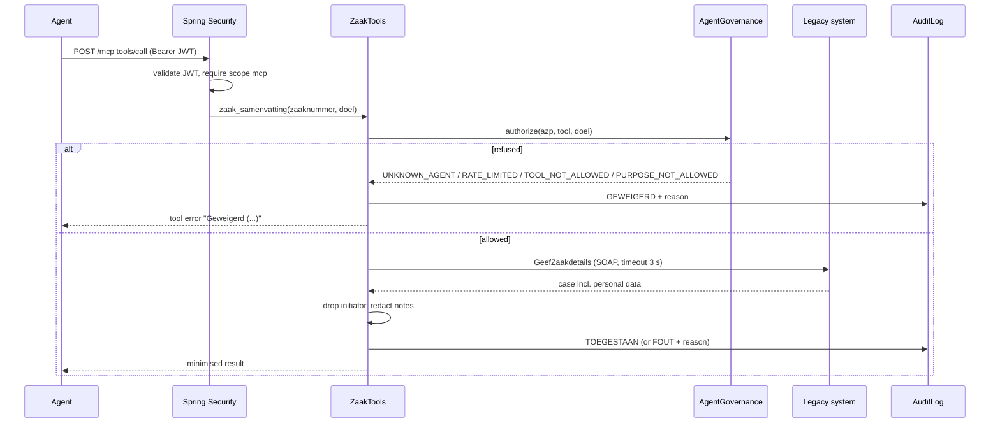

# Architecture

## Context

The legacy case system ("zaaksysteem") of Gemeente Voorbeeldstad is the system of record for permits and other cases. It offers one SOAP operation, `GeefZaakdetails`, loosely modelled on StUF-ZKN. It cannot be changed, it returns everything it knows about a case including personal data, and it is sometimes slow.

Two kinds of consumers want that data:

- **Internal applications** (a case worker portal, for example) through a modern REST API.
- **AI agents** (a customer-contact assistant, a reporting agent) through MCP, the protocol LLM agents use to discover and call tools.

The gateway serves both, and treats agents as a separate, less trusted class of caller.

## Components

| Package | Responsibility |
|---|---|
| `zaak` | Legacy adapter. Builds the SOAP request with escaped values, calls the legacy system with strict connect and read timeouts, and parses the response with a hardened XML parser. Maps legacy faults to three exceptions: invalid case number, not found, unavailable. |
| `api` | REST facade (`/api/v1/zaken/{zaaknummer}`) for internal applications, with RFC 9457 problem details. |
| `mcp` | MCP tools `zaak_status` and `zaak_samenvatting`. Each call goes through the same pipeline (below). |
| `governance` | Agent registry and policy decision: registered agent, rate limit, allowed tool, allowed purpose. |
| `privacy` | PII redaction of free text: known names first, then patterns (e-mail, IBAN, phone, BSN, postcode). |
| `audit` | Audit trail in PostgreSQL (Flyway-managed) and `GET /api/v1/audit` for the privacy officer. |
| `security` | OAuth2 resource server: JWT validation and scope rules per endpoint. |

## A tool call, step by step

## Design decisions

**Governance in the gateway, not in the prompt.** A system prompt saying "do not share personal data" is a request, not a control. The gateway decides what leaves the building, so the rules hold whatever the agent, its model or its prompt does.

**The agent's identity comes from the token.** The tools take no "agent" parameter; the gateway reads the OAuth2 client id (`azp`) from the validated JWT. An agent cannot claim to be another agent. The MCP request runs on the servlet thread, so the tool sees the authenticated principal through the security context.

**Deny by default, refuse with a reason.** Unregistered agents get nothing. Refusals return a stable reason code, so agent developers can see why a call failed and auditors can count refusals per reason.

**Agents get less than applications.** There is no MCP equivalent of the `zaken.persoonsgegevens` scope: agents never receive the initiator, and case notes are always redacted. An application that needs personal data uses the REST API with an explicit scope.

**The audit trail is not a second copy of the data.** It records who, what, why and the outcome, never case content. Values supplied by the agent are only stored when well-formed (`ZAAK-2026-000123`, a known purpose); anything else becomes `[ongeldig]`, so an agent cannot write a BSN or a log-injection payload into it.

**The legacy system is untrusted too.** Its responses are parsed with DOCTYPEs and external entities disabled, and its error details never reach the caller.

**Rate limit before authorisation checks.** An agent probing for tools it may not use is throttled as well.

## Production notes

- **Identity provider.** Remove `GATEWAY_SECURITY_DEV_JWT_SECRET` and set the issuer URI; register each agent as an OAuth2 client with only the scopes it needs.
- **Rate limits with more than one replica.** The buckets are in memory, per instance. With several replicas, use a Bucket4j distributed backend (JDBC, Redis) or enforce the limit at the ingress as well.
- **Audit retention.** Agree on a retention period with the privacy officer and add a scheduled cleanup; ship the audit events to the SIEM as well.
- **Configuration as code.** The agent registry is configuration, so changes go through review. A database-backed registry with an admin UI is a possible next step.
